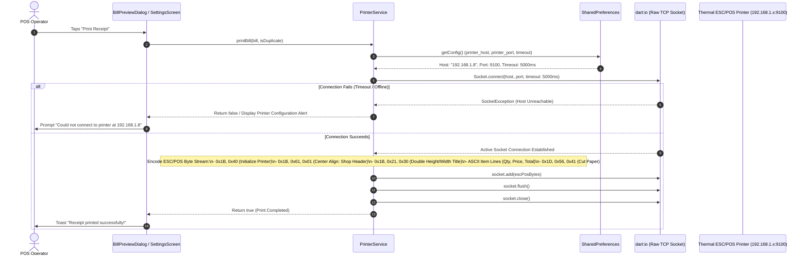
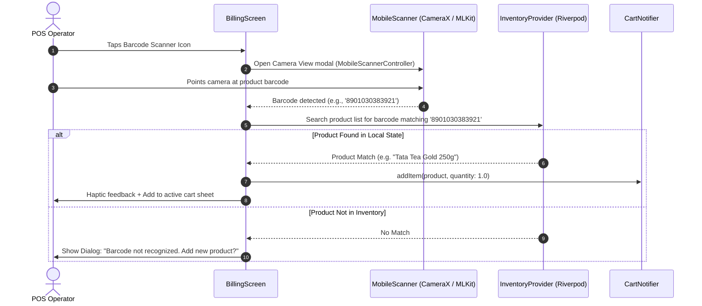
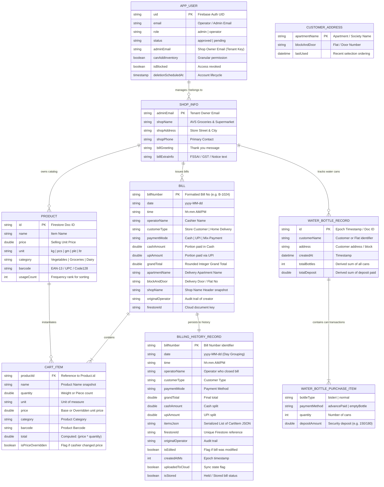

# Architecture Diagram & Technical Specifications: GroAppBill (AVS Billing)

An offline-first, high-throughput Point of Sale (POS) and inventory billing mobile application built with Flutter, Riverpod, Google Cloud Firestore, raw ESC/POS network socket thermal printing, and integrated camera barcode scanning.

---

## 1. High-Level System Architecture

```mermaid
flowchart TD
    subgraph ClientDevice["Android Hardware & OS Layer"]
        OS["Android OS (minSdk 21 / Android 5.0+ | targetSdk 34)"]
        Cam["Device Camera (Barcode Scanner)"]
        WiFi["Wi-Fi / Network Interface (ESC/POS 9100)"]
        NetState["Connectivity Service (Wi-Fi / Cellular)"]
        ShareSheet["Android Native Sharesheet (WhatsApp/SMS Intent)"]
    end

    subgraph FlutterEngineLayer["Flutter Engine & Platform Channels"]
        Channels["Platform Channels (Engine BinaryMessenger)"]
        ScannerPlugin["mobile_scanner (CameraX / MLKit Barcode)"]
        ConnPlugin["connectivity_plus (Network State Listener)"]
        SharePlugin["share_plus (ACTION_SEND Intent)"]
        PrefsPlugin["shared_preferences (SharedPreferences Key-Value)"]
    end

    subgraph PresentationLayer["Presentation Layer (Flutter UI & Material 3)"]
        Theme["Theme & Design System (VibrantBackground, GlassContainer)"]
        Screens["Screens\n- LoginScreen & PendingApproval\n- HomeScreen (Multi-Tab POS)\n- BillingScreen (Multi-Cart POS)\n- CartScreen & BillPreviewDialog\n- CalculatorScreen\n- HistoryScreen (Day Book)\n- WaterBottleScreen\n- Inventory/AdminScreen\n- SettingsScreen"]
        Widgets["Reusable Widgets\n- NumpadInputSheet\n- ProductFormDialog\n- CartSelectionTabs\n- CategorySortButton\n- AddressInfoCard"]
    end

    subgraph BusinessLogicLayer["State Management & Controllers (Riverpod 2.x)"]
        AuthProv["Auth Providers\n(userProvider, appUserProvider, shopOwnerEmailProvider)"]
        CartProv["Cart Notifier\n(cartProvider - StateNotifier with 5 Concurrent Carts)"]
        BillingCtrl["Billing Controller\n(billDraftProvider, checkout actions)"]
        InvProv["Inventory Providers\n(inventoryStreamProvider, productSearchProvider)"]
        HistProv["History Providers\n(historyProvider, pendingUploadCountProvider)"]
        WaterProv["Water Bottle Providers\n(waterBottleStreamProvider, filterProvider)"]
        ShopProv["Shop Metadata Provider\n(shopInfoProvider)"]
        NavProv["Navigation & Tab Provider\n(currentTabProvider)"]
    end

    subgraph DataServiceLayer["Data, Domain & Service Orchestration Layer"]
        AuthSvc["AuthService\n(Firebase Auth, Token Persistence, Role Guards)"]
        SyncSvc["SyncService\n(Firestore Batch Writes, Realtime Product Streams)"]
        HistSvc["HistoryService\n(Offline Queue, 2-Day Rolling Purge, Cloud Sync)"]
        PrintSvc["PrinterService\n(Raw TCP Socket ESC/POS 80mm/58mm Driver)"]
        WaterSvc["WaterBottleService\n(Cans Ledger, Deposits, Empty Bottle Tracking)"]
        Utils["Utility Engines\n(CalculatorEngine, BillShareFormatter)"]
    end

    subgraph PersistenceLayer["Local Persistence & Offline Cache"]
        SP["SharedPreferences\n- billing_history (JSON-serialized bills)\n- billing_pending_upload (Offline Sync Queue)\n- printer_host, printer_port, timeout\n- customer_addresses & shop_info"]
        FirestoreCache["Cloud Firestore Local Cache\n(IndexedDB / SQLite LevelDB Offline Persistence)"]
    end

    subgraph ExternalServices["External Cloud & Network Services"]
        FirebaseAuth["Firebase Authentication\n(Email/Password, Identity Tokens)"]
        CloudFirestore["Cloud Firestore\n- users/{uid}\n- shops/{adminEmail}/products/{id}\n- shops/{adminEmail}/bills/{billId}\n- shops/{adminEmail}/waterBottleRecords/{id}"]
        ThermalPrinter["ESC/POS Thermal Receipt Printer\n(Raw TCP Socket on 192.168.x.x:9100)"]
        WhatsAppTarget["WhatsApp Messenger / External Apps\n(Text Bill Receipt via Share API)"]
    end

    %% Hardware to Platform bindings
    Cam --> ScannerPlugin
    NetState --> ConnPlugin
    WiFi --> PrintSvc
    ShareSheet --> SharePlugin
    OS --> PrefsPlugin

    %% Platform plugins to presentation/services
    ScannerPlugin --> Screens
    ConnPlugin --> HistSvc
    SharePlugin --> Utils
    PrefsPlugin --> SP

    %% UI to State Management
    Screens --> AuthProv
    Screens --> CartProv
    Screens --> BillingCtrl
    Screens --> InvProv
    Screens --> HistProv
    Screens --> WaterProv
    Screens --> ShopProv
    Widgets --> CartProv

    %% State Management to Services
    AuthProv --> AuthSvc
    CartProv --> BillingCtrl
    BillingCtrl --> HistSvc
    BillingCtrl --> PrintSvc
    InvProv --> SyncSvc
    HistProv --> HistSvc
    WaterProv --> WaterSvc
    ShopProv --> SP

    %% Services to Local Storage
    HistSvc --> SP
    SyncSvc --> FirestoreCache
    PrintSvc --> SP
    AuthSvc --> SP

    %% Services to Remote Services
    AuthSvc --> FirebaseAuth
    SyncSvc --> CloudFirestore
    HistSvc --> CloudFirestore
    WaterSvc --> CloudFirestore
    PrintSvc -.->|Raw TCP Socket :9100| ThermalPrinter
    Utils -.->|Share Intent| WhatsAppTarget
```



---

## 2. Technology Stack Matrix Table

| Layer / Category | Technology | Exact Version (Configured) | Architectural Responsibility |
| :--- | :--- | :--- | :--- |
| **Framework & Core SDK** | Flutter SDK | `>=3.11.1` (Targeting 3.27+) | Cross-platform UI toolkit, rendering pipeline, widget tree lifecycle. |
| **Language** | Dart SDK | `^3.11.1` | Sound null-safety, async runtime, streams, collections, pattern matching. |
| **State Management** | `flutter_riverpod` | `^2.4.0` | Reactive state management, dependency injection, provider scoping (`ProviderScope`). |
| **State Code Generation** | `riverpod_annotation` | `^2.3.0` | Type-safe annotated provider boilerplate generation. |
| **Authentication Service** | `firebase_auth` | `^5.3.0` | User authentication, identity tokens, session persistence (`Persistence.LOCAL`). |
| **Remote Database** | `cloud_firestore` | `^5.4.0` | Cloud document storage with offline persistence enabled (`cacheSizeBytes: UNLIMITED`). |
| **Firebase Foundation** | `firebase_core` | `^3.6.0` | Firebase native initialization bridge (`Firebase.initializeApp`). |
| **Local Persistence** | `shared_preferences` | `^2.2.0` | Key-value storage for bills queue, addresses, printer settings, operator sessions. |
| **Hardware Integration** | `mobile_scanner` | `^5.2.3` | CameraX-based hardware barcode scanner (EAN-13, UPC-A, Code 128, QR Code). |
| **Network & Socket IO** | `dart:io` (Socket) & `http` | Built-in / `^1.1.0` | Raw TCP socket client communicating with thermal ESC/POS printers on port 9100; REST utilities. |
| **Connectivity Listener** | `connectivity_plus` | `^6.0.3` | Network status detection (`Wi-Fi`, `Cellular`, `None`) driving offline auto-sync. |
| **Sharing & System Intents** | `share_plus` | `^10.1.4` | Native Android `ACTION_SEND` intent dispatch for WhatsApp receipt generation. |
| **Internationalization** | `intl` | `^0.19.0` | Date formatting, currency parsing, localized time-stamps. |
| **Iconography** | `cupertino_icons` | `^1.0.8` | Cupertino iOS glyphs for cross-platform visual consistency. |
| **Android Gradle Plugin** | AGP (`com.android.application`) | `8.7.0` | Android build toolchain, APK/AAB compilation, resource merging. |
| **Kotlin Gradle Plugin** | Kotlin JVM | `2.1.0` | Kotlin compiler target (`JavaVersion.VERSION_17`). |
| **Google Services Plugin**| `com.google.gms.google-services` | Applied in build | Injects Firebase parameters from `google-services.json`. |
| **Native Android Specs** | Android SDK / NDK | `minSdk: 21`, `targetSdk: 34`, JVM 17 | Compatible with Android 5.0 (Marshmallow+) up to modern Android 14+. |
| **Linter / Quality** | `flutter_lints` | `^6.0.0` | Strict static analysis enforcing Dart idioms. |

---

## 3. Component & Module Relationships Diagram

```mermaid
flowchart LR
    subgraph UI_Presentation["Presentation (Screens & UI Components)"]
        BS["BillingScreen"]
        CS["CartScreen"]
        HS["HistoryScreen"]
        WS["WaterBottleScreen"]
        AS["AdminScreen"]
        PD["BillPreviewDialog"]
    end

    subgraph State_Management["Riverpod Providers & Controllers"]
        CP["cartProvider\n(CartStateNotifier - 5 Carts)"]
        BC["billingControllerProvider\n(Checkouts & Bill Calculations)"]
        IP["inventoryStreamProvider\n(Product catalog stream)"]
        HP["historyProvider\n(Today's Bills & Aggregations)"]
        WP["waterBottleProvider\n(Water Can Stream & Stats)"]
        AP["appUserProvider\n(Auth & Permission Guard)"]
    end

    subgraph Services_Layer["Business Services & Hardware Integrations"]
        AuthS["AuthService"]
        SyncS["SyncService"]
        HistS["HistoryService"]
        PrintS["PrinterService"]
        WaterS["WaterBottleService"]
        FormatS["BillShareFormatter"]
    end

    subgraph Storage_Layer["Persistence & Remote Sources"]
        LocalPrefs[("SharedPreferences\n- JSON Billing History\n- Pending Uploads\n- Printer IPs")]
        CloudDB[("Google Cloud Firestore\n- users\n- shops/{email}/products\n- shops/{email}/bills")]
        PrinterHw[["Thermal Receipt Printer\n(TCP/IP Port 9100)"]]
    end

    %% UI to State
    BS -->|Watch items & Carts| CP
    BS -->|Select Products| IP
    CS -->|Trigger checkout| BC
    HS -->|Watch Daily Sales| HP
    WS -->|Record Water Transactions| WP
    AS -->|Manage Catalog| IP
    PD -->|Format Receipt Text| FormatS

    %% State to Services
    CP -->|Holds CartItem lists| BC
    BC -->|Persist Bill| HistS
    BC -->|Print Receipt| PrintS
    IP -->|Fetch Realtime Items| SyncS
    HP -->|Load/Delete Bills| HistS
    WP -->|Record Can Sales| WaterS
    AP -->|Listen Auth Stream| AuthS

    %% Services to Data Sources
    HistS -->|Read/Write Cache| LocalPrefs
    HistS -->|Sync Queue (when online)| CloudDB
    SyncS -->|Real-time Snapshot Sync| CloudDB
    WaterS -->|Real-time Snapshot Sync| CloudDB
    PrintS -->|Stream ESC/POS Bytes| PrinterHw
    AuthS -->|Fetch User Profile| CloudDB
```

---

## 4. End-to-End Sequence Diagrams

### 4.1 Primary Workflow: Checkout, Offline-First Persistence, and Network-Triggered Cloud Sync

```mermaid
sequenceDiagram
    autonumber
    actor Operator as POS Operator
    participant UI as BillingScreen / CartScreen
    participant Cart as CartNotifier (Riverpod)
    participant HistSvc as HistoryService
    participant LocalCache as SharedPreferences
    participant Conn as ConnectivityPlus Listener
    participant Firestore as Cloud Firestore (Remote)

    Operator->>UI: Selects Payment Mode ('Cash' / 'UPI' / 'Mix') and taps 'Checkout'
    UI->>Cart: Finalize Cart (Generate Bill Entity)
    Cart-->>UI: Bill Object (ID, Items, Grand Total, Operator)
    UI->>HistSvc: saveBill(bill, adminEmail)
    
    rect rgb(30, 45, 60)
        note over HistSvc,LocalCache: Immediate Offline Guarantee
        HistSvc->>LocalCache: Read existing billing_history
        HistSvc->>LocalCache: Append Bill to 'billing_history' (JSON)
        HistSvc->>LocalCache: Append Bill to 'billing_pending_upload' queue
        HistSvc-->>UI: Return Success (Bill saved locally)
    end
    
    UI->>Operator: Show Bill Preview Dialog & Option to Print / Share

    alt Device is Currently Online
        HistSvc->>Firestore: Set document shops/{adminEmail}/bills/{docId}
        Firestore-->>HistSvc: Write Acknowledged
        HistSvc->>LocalCache: Mark 'uploadedToCloud: true' & remove from 'billing_pending_upload'
    else Device is Offline
        note over HistSvc,LocalCache: Network unreachable: Retains bill in pending upload queue
    end

    opt Later: Network Connectivity Regained
        Conn->>HistSvc: onConnectivityChanged(!= none)
        HistSvc->>LocalCache: Read 'billing_pending_upload'
        loop For each pending bill
            HistSvc->>Firestore: Push document to shops/{adminEmail}/bills/
            Firestore-->>HistSvc: 200 OK
            HistSvc->>LocalCache: Remove from pending queue
        end
    end
```



### 4.2 Hardware Workflow: Raw TCP Socket ESC/POS Thermal Printing



### 4.3 Scanner Workflow: Hardware Camera Barcode Lookup



---

## 5. Data Model & Entity-Relationship Diagram



---

## 6. API & Service Integration Reference Table

| Service / Remote Target | Protocol / Transport | Auth Mechanism | Endpoints / Document Paths | Payload / Query Details | Client Interceptors & Sync Policies |
| :--- | :--- | :--- | :--- | :--- | :--- |
| **Firebase Auth** | HTTPS / TLS | Secure API Key & JWT Refresh Tokens | `identitytoolkit.googleapis.com` (Auth SDK) | Email, Password, Session Tokens | Token auto-refresh, cached locally with `FirebaseAuth.instance.setPersistence(Persistence.LOCAL)`. |
| **Firestore User Management** | gRPC / HTTPS Channel | Firebase App Check / Token Bearer | `users/{uid}` | `AppUser` document: `{email, role, status, adminEmail, canAddInventory}` | Realtime listener via `AuthService.appUserStream` with automatic account de-provisioning on `isBlocked`. |
| **Firestore Product Catalog** | gRPC / HTTPS Channel | Rule based on `request.auth.uid` | `shops/{adminEmail}/products/{productId}` | `Product` JSON document with batch commit updates | `SyncService.productsStream(adminEmail)` listens to realtime snapshot feeds; batched writes during admin sync. |
| **Firestore Bills History** | gRPC / HTTPS Channel | Tenant matching `adminEmail` | `shops/{adminEmail}/bills/{docId}` | `BillingHistoryRecord` document with nested cart items | Offline write queuing via `cloud_firestore` persistence and manual retry queue in `SharedPreferences` (`billing_pending_upload`). |
| **Firestore Water Bottle Ledger** | gRPC / HTTPS Channel | Tenant matching `adminEmail` | `shops/{adminEmail}/waterBottleRecords/{id}` | Water records with nested purchase cans and deposit statuses | Snapshot stream `WaterBottleService.recordsStream(adminEmail)` with immediate offline write availability. |
| **ESC/POS Thermal Printer** | Raw TCP Socket (`dart:io`) | Local Subnet (No Auth) | `tcp://{printer_host}:{printer_port}` (Default: `192.168.1.8:9100`) | Standard ESC/POS byte sequence (Font initialization, text columns, barcodes, cut commands) | Sockets opened on-demand, sent synchronously with configurable timeout (5000ms), immediately flushed and closed. |
| **WhatsApp / Native Share** | Android Intent IPC | Native OS Sandboxing | `android.intent.action.SEND` | Formatted multi-line text receipt with item details, grand total, and shop metadata | Executed via `share_plus` plugin; directly invokes Android intent picker for WhatsApp messaging. |

---

## 7. Android Build & Packaging Architecture

### 7.1 Gradle & Android SDK Architecture
- **Build System**: Gradle 8.10 (`gradle-8.10-all.zip`) with Android Gradle Plugin 8.7.0 and Kotlin 2.1.0 DSL (`build.gradle.kts` & `settings.gradle.kts`).
- **Java Virtual Machine**: Target compatibility set to **Java 17** (`JavaVersion.VERSION_17`).
- **SDK Target Bounds**:
  - `minSdkVersion`: Android 5.0 (API level 21 - Marshmallow / Lollipop backwards compatibility).
  - `targetSdkVersion`: Android 14 (API level 34).
  - `compileSdkVersion`: Matches Flutter's highest compile target (`flutter.compileSdkVersion`).
- **Application ID**: `com.example.groappbill` (Configured under `android.defaultConfig`).
- **Manifest Permissions**:
  - `android.permission.WAKE_LOCK`: Ensures device CPU stays awake during continuous barcode scanning or active checkout sessions.
  - `android.permission.ACCESS_WIFI_STATE`: Required for Wi-Fi printer connectivity checks and network status listeners.
  - `android:usesCleartextTraffic="true"`: Allows unencrypted raw socket communication with ESC/POS printers on the local LAN.

### 7.2 Build Packaging & Release Targets
- **Build Targets**:
  - **APK (Split-per-ABI / Fat)**: `flutter build apk --release` (Generates standalone APK for direct installation on POS Android hardware).
  - **App Bundle (`.aab`)**: `flutter build appbundle --release` (Optimized dynamic binaries for Google Play Console distribution).
- **R8 / ProGuard Minification**:
  - Android Gradle Plugin applies R8 code-shrinking for release builds.
  - Keeps Flutter embedding, Firebase models, and reflection classes (`mobile_scanner`, `cloud_firestore`).
- **Signing Configurations**:
  - Configured with standard debug keys for rapid sideloading on merchant testing devices.
  - Production builds support key injection via environment variables or `key.properties`:
    ```kotlin
    signingConfigs {
        create("release") {
            storeFile = file(project.property("MYAPP_RELEASE_STORE_FILE") ?: "keystore.jks")
            storePassword = project.property("MYAPP_RELEASE_STORE_PASSWORD") as String?
            keyAlias = project.property("MYAPP_RELEASE_KEY_ALIAS") as String?
            keyPassword = project.property("MYAPP_RELEASE_KEY_PASSWORD") as String?
        }
    }
    ```

---

## 8. Portfolio & Showcase Summary

### 8.1 Executive Technical Summary
**GroAppBill (AVS Billing)** is an enterprise-grade, offline-first mobile Point of Sale (POS) and inventory billing system engineered specifically for supermarket environments and rapid retail checkouts. Architected using **Flutter 3**, **Riverpod 2.x**, and **Google Cloud Firestore**, the application solves critical grocery retail pain points:
- **Zero-Downtime Offline Checkout**: Bills are immediately written to local flash storage and committed to an offline queue that guarantees uninterrupted cashier billing during network outages, synchronizing silently when connectivity resumes.
- **5-Slot Multi-Cart Concurrency**: Cashiers can seamlessly switch between up to 5 concurrent shopping carts without losing intermediate scans when customers leave to retrieve additional items.
- **Hardware Integration**: High-speed camera barcode scanning via Google ML Kit / CameraX and raw byte-level TCP socket drivers communicating directly with network ESC/POS 80mm/58mm thermal receipt printers.
- **Role-Based Tenant Isolation**: Multi-tenant architecture allowing single shop owners (admins) to supervise multiple operators with strict access controls, catalog management, and daily sales auditing.

### 8.2 By The Numbers

| Metric | Measurement | Technical Context |
| :--- | :--- | :--- |
| **Screens & Views** | **10** Production Views | Auth, Multi-Cart POS, Cart, Calculator, History, Water Ledger, Admin, Settings, etc. |
| **Domain Models** | **9** Data Entities | Typed models with JSON serialization, copyWith patterns, and business rules. |
| **State Providers** | **10+** Reactive Providers | Riverpod StateNotifiers, AsyncNotifiers, StreamProviders, and Filter Notifiers. |
| **Services & Engines** | **6** Specialized Engines | AuthService, HistoryService, PrinterService, SyncService, WaterBottleService, CalculatorEngine. |
| **Custom Widgets** | **8+** Modular Components | GlassContainer, NumpadInputSheet, ProductFormDialog, CartSelectionTabs, etc. |
| **Target Android OS** | **Android 5.0 to 14** (API 21 - 34) | Backwards compatibility ensuring deployment on 8-year-old low-cost POS terminals. |
| **Offline Buffer** | **Unlimited Persistence** | SharedPreferences queue + Firestore SQLite levelDB cache. |

### 8.3 Copy-Paste Ready LinkedIn Showcase Post

```markdown
🚀 Excited to showcase GroAppBill — a high-performance, offline-first Point of Sale (POS) and inventory management mobile application built with Flutter & Firebase!

Supermarket checkouts require zero latency and 100% uptime. To solve this, I engineered a retail billing application tailored for rapid operations:

Key Architectural Highlights:
⚡ Offline-First Resilience: Integrated a dual-layer caching engine combining SharedPreferences queue buffers with Cloud Firestore offline persistence. The app bills customers flawlessly with zero internet, auto-syncing when back online.
🛒 5-Slot Multi-Cart Concurrency: Cashiers can switch between 5 active customer carts instantaneously with Riverpod StateNotifiers without losing scanned items.
🖨️ Direct ESC/POS Hardware Integration: Developed a native TCP socket client in Dart that streams raw ESC/POS byte buffers directly to 80mm/58mm thermal receipt printers over local Wi-Fi (Port 9100).
📸 Hardware Barcode Scanning: Embedded CameraX & Google ML Kit via mobile_scanner for rapid SKU detection and instant cart insertion.
🔐 Multi-Tenant Role Isolation: Granular role-based access control (Admin vs. Operator) with approval workflows, real-time inventory updates, and daily ledger auditing.

Tech Stack: Flutter, Dart, Riverpod 2.x, Firebase Auth & Cloud Firestore, ESC/POS Thermal Printing, Material 3 Glassmorphism UI.

#Flutter #MobileDevelopment #Firebase #Riverpod #PointOfSale #SoftwareArchitecture #AndroidDev #CleanCode #DartLang
```
